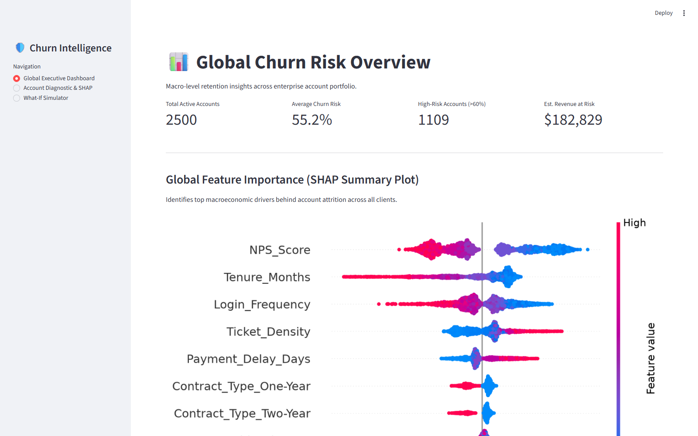
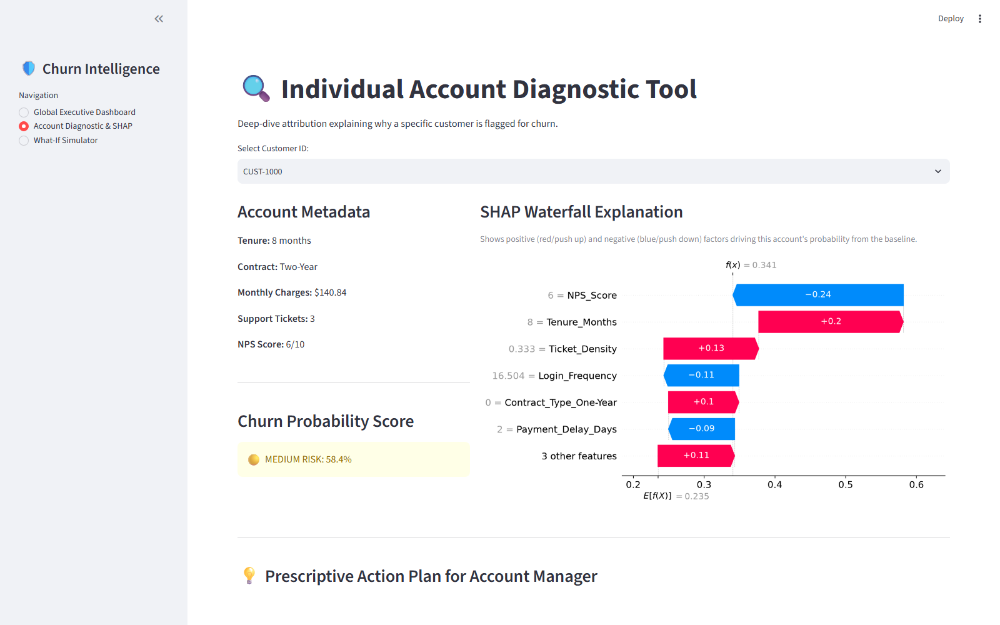
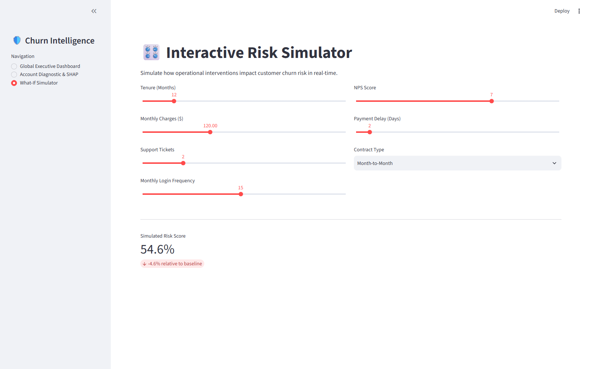

# Customer Churn Intelligence Platform 🛡️

Most churn dashboards tell you *who* is about to leave. This one also tells you *why* — and what you can do about it.

It's a Streamlit app built around a LightGBM model that predicts churn probability for each customer account, with SHAP values underneath every prediction so the numbers actually mean something. Instead of a black-box risk score, you get a full breakdown of which factors pushed a customer toward leaving, and a set of recommended actions for the account manager.

## What's inside

The app has three pages, each answering a different question:

**📊 Global Executive Dashboard** — the 10,000-foot view. Total accounts, average churn risk, how many customers are in the danger zone (>60% probability), and estimated revenue at risk. Below that, a SHAP summary plot shows which features are driving churn across the whole portfolio.



**🔍 Account Diagnostic & SHAP** — pick any customer and see everything about them: their tenure, contract type, support ticket history, NPS score, and their churn probability (color-coded red/yellow/green). The SHAP waterfall then breaks that score down feature by feature — e.g. "their low NPS score added +0.24 to the risk, but their recent logins pulled it back by −0.11." It ends with a prescriptive action plan (discount offers, support escalations, payment reminders) based on the actual drivers.



**🎛️ What-If Simulator** — move the sliders and watch the risk score respond in real time. What happens if the customer moves from month-to-month to a two-year contract? If their NPS drops from 7 to 4? Handy for stress-testing "what would make this customer stay" scenarios before the renewal call.



## How the model works

`train.py` runs the full pipeline:

1. Generates a synthetic enterprise dataset (2,500 accounts with realistic features — tenure, monthly charges, support tickets, login frequency, NPS, contract type, payment delays — plus an engineered `Ticket_Density` feature)
2. Tunes a LightGBM classifier with **Optuna** (15 trials)
3. Trains the final model and evaluates it with ROC-AUC and PR-AUC
4. Saves everything the app needs: the model, a TreeSHAP explainer, the training columns, and the raw data

On the last run, the tuned model hit a **ROC-AUC of ~0.76** on the held-out test set.

> Note: the data is synthetic (generated with known churn dynamics baked in), so this project is really a demonstration of the *pattern* — model + explanations + prescriptive actions — rather than production-grade predictions. Swap `generate_enterprise_data()` for your real customer data and the rest of the pipeline works as-is.

## Running it locally

```bash
pip install -r requirements.txt

# train the model and generate the artifacts
python train.py

# launch the app
streamlit run app.py
```

That's it — no API keys, no database. The app loads the saved `.pkl` artifacts on startup.

## Tech stack

- **LightGBM** — gradient boosting model
- **Optuna** — hyperparameter tuning
- **SHAP (TreeExplainer)** — global summary plots + per-customer waterfalls
- **Streamlit** — dashboard, navigation, and the interactive simulator
- **scikit-learn / pandas / NumPy** — preprocessing, metrics, and data wrangling

## Ideas for later

- Plug in a real dataset and add a CSV upload page
- Model drift monitoring as new data arrives
- Export the prescriptive action plans as reports for account managers
